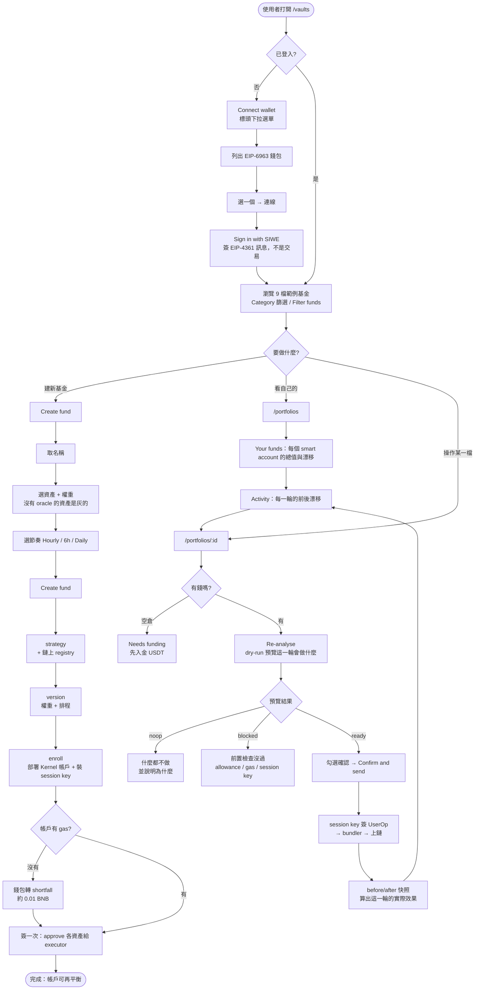
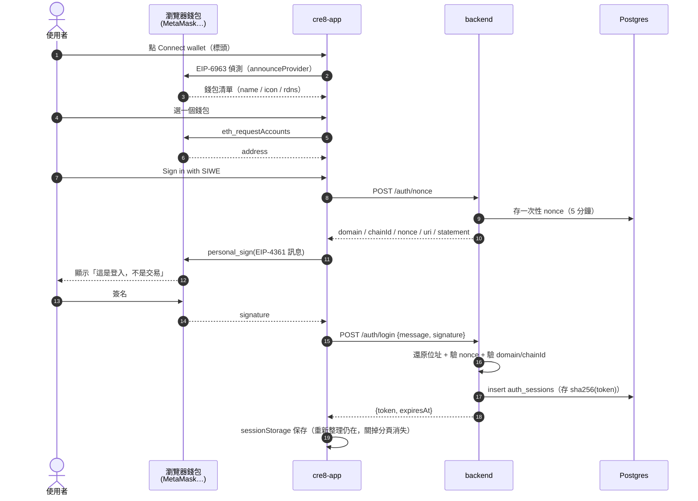
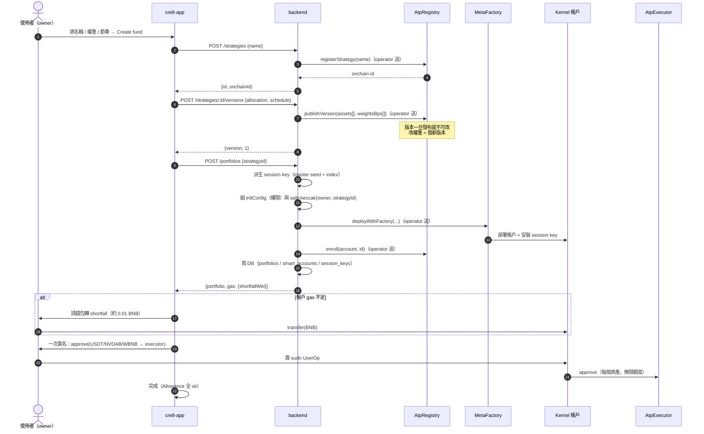
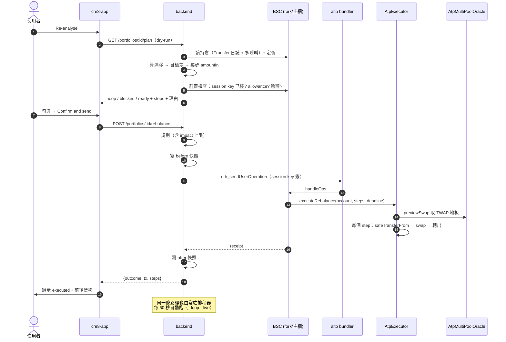
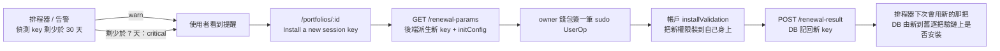

# User flows

> 這份文件畫的是**使用者實際會走的路徑**，以及每一步在後端／鏈上發生什麼事。
> 對照程式碼：`src/components/WalletMenu.tsx`（登入）、`src/features/create/CreateFundPage.tsx`（建基金）、
> `src/features/rebalance/RebalanceCard.tsx`（再平衡）、`src/features/renewal/RenewalCard.tsx`（續期）。

---

## 0. 一張圖看完

---

## 1. 登入（沒有交易、沒有 gas）

**重點**：SIWE 只是證明「你擁有這個位址」。**鏈上權限與 session key 完全不受影響** ——
登入與否不改變任何合約狀態。

---

## 2. 建立基金：3 個 API + 2 次錢包互動

**為什麼 approve 是 owner 簽、而部署不是**：`AtpExecutor._swap` 用 ERC-20
`safeTransferFrom` 從**帳戶**拉幣，所以 allowance 必須由帳戶給。session key 給不了
（CallPolicy 只白名單 `executeRebalance`），而後端沒有 owner 私鑰。詳見 `architecture.md`。

---

## 3. 一輪再平衡（沒有簽名）

---

## 4. Session key 到期 → 續期

**舊 key 不會被撤銷** —— 它到自己的到期日為止仍然有效。這是刻意的：撤銷需要另一筆交易，
而多一把有效 key 的風險低於「續期失敗導致資金卡住」。

---

## 5. 失敗時使用者會看到什麼

| 情況 | 使用者看到的 | 系統實際狀態 |
|---|---|---|
| 錢包拒絕簽名 | 選單裡留著錯誤訊息，可重試 | 沒有任何鏈上動作 |
| 帳戶沒 gas | approve 失敗，訊息說明 gas | 帳戶存在但付不出 op |
| 沒 approve | 預覽 `blocked`：`ALLOWANCE_TOO_LOW` | 不送交易（不浪費 gas） |
| 空倉 | 預覽 `noop`：`Portfolio value is 0` | 沒有部位可搬 |
| 沒 oracle 的資產 | create 頁該列灰掉 | 選單就擋住，不會建出跑不了的策略 |
| fork/RPC 掛掉 | 503 + 說明「讀不到狀態」 | **不顯示任何漂移數字**（刻意的） |
| 算不出執行後漂移 | `cannot be estimated yet` | 保留完整間隔，不亂調度 |
